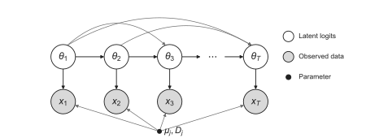
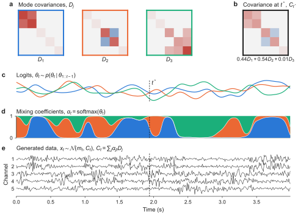
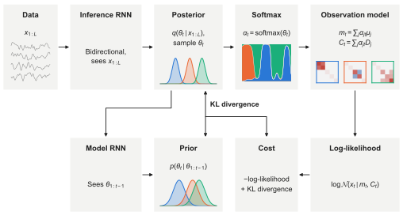
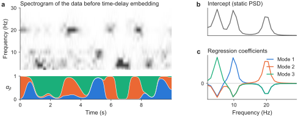

Dynamic Network Modes (DyNeMo)
==============================

DyNeMo [2] relaxes two assumptions of the :doc:`HMM <hmm>`:

- **Mutually exclusive states**: DyNeMo describes the data with a linear mixture of **modes**, so several networks can be active at the same time.
- **The Markovian assumption**: DyNeMo uses a recurrent neural network (RNN) as its temporal model, which can capture long-range temporal dependencies.

DyNeMo has been used to study resting-state [2] and task [6] MEG data. It can find task responses that the HMM misses, because a mixture can describe networks that overlap in time [6].

.. list-table::
   :widths: 25 75

   * - Time course
     - Modes: the mixing coefficients of each network at each time point
   * - Observation model
     - Multivariate normal, with a mean and covariance that are linear mixtures of the mode means and covariances
   * - Temporal model
     - Recurrent neural network (LSTM [4] by default)
   * - Training
     - Amortized variational inference, a GPU helps
   * - API
     - :class:`~osl_dynamics.models.dynemo.Config`, :class:`~osl_dynamics.models.dynemo.Model`
   * - Tutorials
     - :doc:`DyNeMo Training </tutorials_build/3-3_dynemo_training>`, :doc:`Selecting a Run </tutorials_build/3-4_dynemo_selecting_a_run>`, :doc:`Getting the Inferred Parameters </tutorials_build/3-5_hmm_dynemo_get_inf_params>`, :doc:`DyNeMo post-hoc analysis </tutorial_sections/dynemo_post_hoc>`
   * - Examples
     - `Simulation <https://github.com/OHBA-analysis/osl-dynamics/blob/main/examples/simulation/dynemo_hmm-mvn.py>`_, `Soft mixing <https://github.com/OHBA-analysis/osl-dynamics/blob/main/examples/simulation/dynemo_soft-mixing.py>`_, `Long-range dependencies <https://github.com/OHBA-analysis/osl-dynamics/blob/main/examples/simulation/dynemo_long-range-dep1.py>`_, `MEG (TDE-DyNeMo, rest) <https://github.com/OHBA-analysis/osl-dynamics/tree/main/examples/meg_analysis/tde-dynemo_rest>`_

Generative Model
----------------

The generative model (joint probability distribution) is

.. math::
    p(x_{1:T}, \theta_{1:T}) = p(\theta_1) p(x_1 | \theta_1) \prod_{t=2}^T p(\theta_t | \theta_{1:t-1}) p(x_t | \theta_t),

where :math:`x_{1:T}` is the observed data (:math:`x_1, x_2, ..., x_T`) and :math:`\theta_{1:T}` is a sequence of latent variables called **logits** (:math:`\theta_1, \theta_2, ..., \theta_T`).

The **observation model** is a multivariate normal distribution,

.. math::
    p(x_t | \theta_t) = \mathcal{N}(m_t, C_t),

whose mean and covariance are **linear mixtures** of the mode means, :math:`\mu_j`, and covariances, :math:`D_j`:

.. math::
    m_t = \sum_j \alpha_{jt} \mu_j, \quad C_t = \sum_j \alpha_{jt} D_j.

The **mixing coefficients**, :math:`\alpha_{jt}`, are positive and sum to one at each time point because they are a softmax transform of the logits:

.. math::
    \alpha_{jt} = \{ \mathrm{softmax}(\theta_t / \tau) \}_j,

where :math:`\tau` is a temperature (``initial_alpha_temperature``, which can also be learned with ``learn_alpha_temperature``). A low temperature makes the mixing coefficients closer to a single active mode.

The **temporal model** for the logits is a normal distribution,

.. math::
    p(\theta_t | \theta_{1:t-1}) = \mathcal{N}(m_{\theta_t}, \mathrm{diag}(\sigma^2_{\theta_t})),

whose mean and standard deviation are predicted by a recurrent neural network (the **model RNN**) from all of the previous logits, :math:`\theta_{1:t-1}`. This is what lets DyNeMo learn long-range temporal dependencies: each logit can depend on the whole history, not just the previous time point.

    DyNeMo as a graphical model. Each logit depends on all of the previous logits (gray arcs), not just the previous one as in the :doc:`HMM <hmm>`.

To generate data from DyNeMo, we sample a sequence of logits with the model RNN, transform them into mixing coefficients and sample each data point with a covariance that mixes the mode covariances:

    Simulating data from DyNeMo with three modes. **(a)** The mode covariances (the means are zero). **(b)** The covariance at the time point :math:`t^*`, a mixture of the mode covariances. **(c)** A sequence of logits (here a smooth random process in place of the model RNN). **(d)** The mixing coefficients, a softmax transform of the logits. **(e)** Data sampled with the covariance at each time point.

As with the :doc:`HMM <hmm>`, we train on time-delay embedded (TDE) data to find spectrally distinct modes and only learn the covariances (``learn_means=False``). See the :doc:`time-delay embedding tutorial </tutorials_build/1-4_data_time_delay_embedding>`.

Training
--------

DyNeMo in osl-dynamics [1] infers a posterior distribution for the logits, :math:`q(\theta_t)`, and learns point estimates for the mode means and covariances. It uses **amortized variational inference** [3]: instead of optimizing a separate posterior for each time point, an **inference RNN** learns to predict the posterior from the data. The inference RNN is bidirectional, so the posterior at each time point uses the data before and after it in the sequence, :math:`x_{1:L}`, where :math:`L` is ``sequence_length``:

.. math::
    q(\theta_t | x_{1:L}) = \mathcal{N}(m^{\mathrm{inf}}_t, \mathrm{diag}(\sigma^{\mathrm{inf}}_t)^2).

The inference RNN, model RNN and observation model are trained together by minimizing the **variational free energy**,

.. math::
    \mathcal{F} = -\sum_t \mathbb{E}_{q(\theta_t)} \left[ \log p(x_t | \theta_t) \right] + \sum_t \mathrm{KL} \left[ q(\theta_t | x_{1:L}) \,\|\, p(\theta_t | \theta_{1:t-1}) \right],

where the first term is the negative log-likelihood of the data and the second is the Kullback-Leibler (KL) divergence between the posterior and the prior from the model RNN. The expectation is estimated with samples of the logits from the posterior, using the reparameterization trick [3] so that the gradients can pass through the sampling. The parameters take gradient steps (with the Adam optimizer) on batches of sequences, so DyNeMo scales to large datasets. A derivation of the cost function is :download:`here <images/dynemo-cost-function.pdf>`.

    Amortized variational inference in DyNeMo. The inference RNN predicts the posterior for the logits from the data. Samples of the logits give the mixing coefficients and the log-likelihood of the data, and are passed to the model RNN, which predicts the prior. The cost is the negative log-likelihood plus the KL divergence between the posterior and the prior.

**KL annealing** (``do_kl_annealing=True``) helps training: the KL divergence is multiplied by a factor that increases from 0 to 1 over the first ``n_kl_annealing_epochs`` epochs, so the model first learns to describe the data and then learns the temporal model. The learning rate is constant during KL annealing and decays afterwards (``lr_decay``).

Initialization and Hyperparameters
^^^^^^^^^^^^^^^^^^^^^^^^^^^^^^^^^^

We recommend initializing DyNeMo with :meth:`~osl_dynamics.models.initialization.InitializationMixin.random_subset_initialization`, which trains a few short runs on random subsets of the data and keeps the best::

    model.random_subset_initialization(data, n_init=5, n_epochs=2, take=0.25)
    model.fit(data)

Alternatively, :meth:`model.train <osl_dynamics.models.mod_base.ModelBase.train>` runs the initialization set in the config (``init_method``, ``n_init``, ``n_init_epochs`` and ``init_take``) and then ``fit``. With ``best_of``, it trains several runs and keeps the one with the lowest free energy.

:meth:`~osl_dynamics.models.initialization.InitializationMixin.nfindr_initialization` is an alternative that starts the mode covariances from the corners of the simplex the windowed data covariances lie in (N-FINDR). The run-to-run variability of DyNeMo is larger than the HMM's, so we recommend training several runs and keeping the one with the lowest free energy (:meth:`model.free_energy <osl_dynamics.models.inf_mod_base.VariationalInferenceModelBase.free_energy>`), or the most typical run (:func:`~osl_dynamics.inference.modes.select_run`). See the :doc:`Selecting a Run tutorial </tutorials_build/3-4_dynemo_selecting_a_run>`.

The main hyperparameters are the number of modes (``n_modes``), ``sequence_length``, the number of units in the RNNs (``inference_n_units`` and ``model_n_units``), ``n_kl_annealing_epochs``, ``batch_size``, ``learning_rate`` and ``n_epochs``. The :doc:`FAQ </faq>` discusses how to choose them and what to do if the loss increases during training.

The Mixing Coefficients
^^^^^^^^^^^^^^^^^^^^^^^

After training, :meth:`model.get_alpha <osl_dynamics.models.inf_mod_base.VariationalInferenceModelBase.get_alpha>` returns the mixing coefficients for each session, calculated from the mean of the posterior for the logits. Passing ``remove_edge_effects=True`` uses overlapping sequences to remove the edge effects from splitting the data into sequences. The mode means and covariances are returned by :meth:`~osl_dynamics.models.dynemo.Model.get_means_covariances`. See the :doc:`Getting the Inferred Parameters tutorial </tutorials_build/3-5_hmm_dynemo_get_inf_params>`.

Post-hoc Analysis
-----------------

Post-hoc analysis interprets the inferred mixing coefficients: statistics that summarize how each mode is activated, and the spectral properties (power and coherence) of each mode.

Re-weighting the Mixing Coefficients
^^^^^^^^^^^^^^^^^^^^^^^^^^^^^^^^^^^^

The mixing coefficients do not account for the size of each mode covariance: a mode with a large covariance contributes more to the data than its mixing coefficient suggests. For the summary statistics, we re-weight the mixing coefficients by the trace of each mode covariance and normalize them to sum to one again with :func:`~osl_dynamics.inference.modes.reweight_alphas`. The re-weighted mixing coefficients describe how much each mode contributes to the total power at each time point. The spectral analysis uses the mixing coefficients without re-weighting.

Summary Statistics
^^^^^^^^^^^^^^^^^^

The (re-weighted) mixing coefficients can be summarized directly, e.g. with their mean, standard deviation or kurtosis (how bursty a mode is) for each session. Alternatively, each mode's time course can be binarized into 'on' and 'off' periods by fitting a two-component Gaussian mixture model (:func:`~osl_dynamics.inference.modes.gmm_time_courses`), after which the :doc:`HMM summary statistics <hmm>` (fractional occupancy, lifetimes, intervals and switching rates) can be calculated. See the :doc:`DyNeMo Mixing Coefficients Analysis tutorial </tutorials_build/5-3_dynemo_mixing_coefs>`. The statistics can be compared between groups or conditions with the :doc:`statistical significance testing </user_guide/stats>` tools.

Spectral Analysis
^^^^^^^^^^^^^^^^^

The multitaper approach used with the :doc:`HMM <hmm>` relies on time points where only one state is active, which a mixture does not have. Instead, we calculate the spectral properties of each mode with a **GLM-spectrum** [5]: we calculate a spectrogram from the data before time-delay embedding (and PCA) and fit it as a mixture of the mode spectra weighted by the mixing coefficients. The intercept is the static (time-averaged) PSD and the regression coefficients are the change in the PSD from the static PSD for a one standard deviation increase in a mode's mixing coefficient.

    Regression spectra for simulated data where the power of a different oscillation is proportional to each mode's mixing coefficient. **(a)** The spectrogram of the data and the mixing coefficients. **(b)** The intercept of the regression, the static PSD. **(c)** The regression coefficients for each mode.

This is done by :func:`~osl_dynamics.analysis.spectral.regression_spectra`, which also calculates the change in the cross spectrum between regions normalized by the static power (change in coherence). Pass ``return_coef_int=True`` to get the regression coefficients and intercept separately: we use the coefficients to calculate the power maps and coherence networks of each mode with :func:`~osl_dynamics.analysis.power.variance_from_spectra` and :func:`~osl_dynamics.analysis.connectivity.mean_coherence_from_spectra`, without subtracting the mean over modes. See the :doc:`Spectral Analysis </user_guide/spectra>` page for how to interpret and plot the outputs, and the :doc:`DyNeMo Regression Spectra </tutorials_build/5-1_dynemo_regression_spectra>` and :doc:`DyNeMo Plotting Networks </tutorials_build/5-2_dynemo_plotting_networks>` tutorials.

**The regression spectra approach is recommended for calculating spectral properties with DyNeMo.**

For fMRI data, the mode means and covariances of each subject can be re-estimated with **dual estimation** (:meth:`~osl_dynamics.models.dynemo.Model.dual_estimation`).

Task Data
^^^^^^^^^

With task data, the mixing coefficients can be epoched around events to show how each mode responds to a task [6]. See the :doc:`Epoching Alphas tutorial </tutorials_build/6-1_epoching_alpha>` and the :doc:`Network Response tutorial </tutorials_build/7-3_network_response>` for statistical testing.

Related Models
--------------

- :doc:`M-DyNeMo <mdynemo>` has separate mixing coefficients for power and functional connectivity.
- :doc:`DyNeStE <dyneste>` uses DyNeMo's RNN temporal model with mutually exclusive states.
- :mod:`DIVE <osl_dynamics.models.dive>` adds session embeddings to model inter-session variability, as :doc:`HIVE <hive>` does for the HMM.
- :mod:`SC-DyNeMo <osl_dynamics.models.sc_dynemo>` is a single-channel version of DyNeMo.

References
----------

1. C Gohil, et al., osl-dynamics, a toolbox for modeling fast dynamic brain activity. `eLife, 2024 <https://elifesciences.org/articles/91949>`_.
2. C Gohil, et al., Mixtures of large-scale dynamic functional brain network modes. `NeuroImage, 2022 <https://doi.org/10.1016/j.neuroimage.2022.119595>`_.
3. D P Kingma, M Welling, Auto-encoding variational Bayes. `arXiv:1312.6114, 2013 <https://arxiv.org/abs/1312.6114>`_.
4. S Hochreiter, J Schmidhuber, Long short-term memory. `Neural Computation, 1997 <https://doi.org/10.1162/neco.1997.9.8.1735>`_.
5. A J Quinn, et al., The GLM-spectrum: A multilevel framework for spectrum analysis with covariate and confound modelling. `Imaging Neuroscience, 2024 <https://doi.org/10.1162/imag_a_00082>`_.
6. C Gohil, et al., Dynamic network analysis of electrophysiological task data. `Imaging Neuroscience, 2024 <https://doi.org/10.1162/imag_a_00226>`_.
