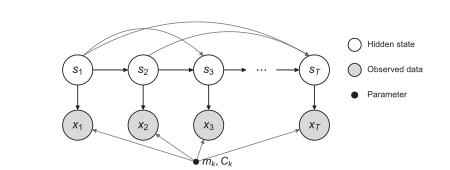
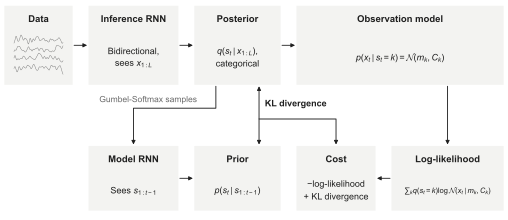
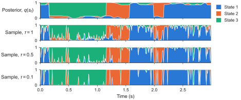

Dynamic Network States (DyNeStE)
================================

DyNeStE [2] combines the **mutually exclusive states** of the :doc:`HMM <hmm>`, which are interpretable and give summary statistics directly, with the **recurrent neural network (RNN) temporal model** of :doc:`DyNeMo <dynemo>`, which can capture long-range temporal dependencies that the HMM's Markovian assumption cannot. On resting-state MEG data, DyNeStE finds plausible network states and captures long-range temporal structure better than the HMM [2].

.. list-table::
   :widths: 25 75

   * - Time course
     - States: one state is active at each time point
   * - Observation model
     - Multivariate normal
   * - Temporal model
     - Recurrent neural network (LSTM by default)
   * - Training
     - Amortized variational inference with the Gumbel-Softmax distribution, a GPU helps
   * - API
     - :class:`~osl_dynamics.models.dyneste.Config`, :class:`~osl_dynamics.models.dyneste.Model`
   * - Examples
     - `Simulation <https://github.com/OHBA-analysis/osl-dynamics/blob/main/examples/simulation/dyneste_hmm-mvn.py>`_, `Long-range dependencies <https://github.com/OHBA-analysis/osl-dynamics/blob/main/examples/simulation/dyneste_long-range-dep.py>`_

Generative Model
----------------

The generative model (joint probability distribution) is

.. math::
    p(x_{1:T}, s_{1:T}) = p(s_1) p(x_1 | s_1) \prod_{t=2}^T p(s_t | s_{1:t-1}) p(x_t | s_t),

where :math:`x_{1:T}` is the observed data and :math:`s_{1:T}` is the sequence of hidden states.

The **observation model** is the same as the :doc:`HMM <hmm>`'s, a multivariate normal distribution with a mean, :math:`m_k`, and covariance, :math:`C_k`, for each state:

.. math::
    p(x_t | s_t = k) = \mathcal{N}(m_k, C_k).

The **temporal model** is where DyNeStE differs from the HMM: the probability of the next state depends on the **whole history** of states, not just the previous state. A recurrent neural network (the **model RNN**) predicts the logits of a categorical distribution from the previous states:

.. math::
    p(s_t | s_{1:t-1}) = \mathrm{Cat}(\mathrm{softmax}(\theta^{\mathrm{mod}}_t)).

    DyNeStE as a graphical model. Each state depends on all of the previous states (gray arcs), not just the previous one as in the :doc:`HMM <hmm>`.

Training
--------

DyNeStE in osl-dynamics [1] uses **amortized variational inference**, as :doc:`DyNeMo <dynemo>` does. A bidirectional **inference RNN** predicts the posterior for the state at each time point from the data in the sequence, :math:`x_{1:L}`:

.. math::
    q(s_t | x_{1:L}) = \mathrm{Cat}(\mathrm{softmax}(\theta^{\mathrm{inf}}_t)).

The cost function is the **variational free energy**, the sum of:

- the negative **log-likelihood** of the data, :math:`-\sum_t \sum_k q(s_t = k) \log \mathcal{N}(x_t | m_k, C_k)`, which uses the state probabilities directly;
- the **KL divergence** between the posterior, :math:`q(s_t | x_{1:L})`, and the prior from the model RNN, :math:`p(s_t | s_{1:t-1})`.

The model RNN takes samples of the state sequence from the **Gumbel-Softmax** (or Concrete) distribution [3, 4], a continuous relaxation of the categorical distribution with differentiable samples. Its temperature, :math:`\tau`, controls how close the samples are to one-hot vectors.

    Amortized variational inference in DyNeStE. The inference RNN predicts the posterior for the states. The log-likelihood uses the state probabilities, and Gumbel-Softmax samples of the states are passed to the model RNN, which predicts the prior. The cost is the negative log-likelihood plus the KL divergence between the posterior and the prior.

    Gumbel-Softmax samples from the same posterior (top) at three temperatures. A lower temperature gives samples that are closer to a sequence of one-hot states.

The temperature can be annealed during training (``do_gs_annealing=True``), from ``initial_gs_temperature`` to ``final_gs_temperature`` over ``n_gs_annealing_epochs`` epochs, so that the samples become closer to discrete states. As with DyNeMo, **KL annealing** (``do_kl_annealing=True``) can be used to stabilize training.

Initialization and Hyperparameters
^^^^^^^^^^^^^^^^^^^^^^^^^^^^^^^^^^

DyNeStE is initialized with :meth:`~osl_dynamics.models.initialization.InitializationMixin.random_state_time_course_initialization` by default (``init_method``). :meth:`model.train <osl_dynamics.models.mod_base.ModelBase.train>` runs the initialization and then ``fit``, and with ``best_of`` it keeps the run with the lowest free energy. The main hyperparameters are the number of states (``n_states``), ``sequence_length``, the number of units in the RNNs (``inference_n_units`` and ``model_n_units``), the Gumbel-Softmax temperatures, ``n_kl_annealing_epochs``, ``batch_size``, ``learning_rate`` and ``n_epochs``. For example::

    from osl_dynamics.models.dyneste import Config, Model

    config = Config(
        n_states=8,
        n_channels=data.n_channels,
        sequence_length=200,
        inference_n_units=64,
        inference_normalization="layer",
        model_n_units=64,
        model_normalization="layer",
        learn_means=False,
        learn_covariances=True,
        do_kl_annealing=True,
        kl_annealing_curve="tanh",
        kl_annealing_sharpness=10,
        n_kl_annealing_epochs=20,
        do_gs_annealing=True,
        gs_annealing_curve="exp",
        initial_gs_temperature=1.0,
        final_gs_temperature=0.06,
        gs_annealing_slope=0.04,
        n_gs_annealing_epochs=40,
        batch_size=32,
        learning_rate=0.005,
        n_epochs=40,
    )
    model = Model(config)
    model.train(data)
    alpha = model.get_alpha(data)

where ``data`` is a :class:`~osl_dynamics.data.Data` object.

Post-hoc Analysis
-----------------

:meth:`model.get_alpha <osl_dynamics.models.inf_mod_base.VariationalInferenceModelBase.get_alpha>` returns the state probabilities, :math:`q(s_t)`. Because DyNeStE infers mutually exclusive states, the post-hoc analysis is the same as for the :doc:`HMM <hmm>`:

- **Summary statistics** of the state time course (from :func:`~osl_dynamics.inference.modes.argmax_time_courses`): fractional occupancy, mean lifetime, mean interval and switching rate. See the :doc:`HMM Summary Statistics tutorial </tutorials_build/4-3_hmm_summary_stats>`.
- **Spectral analysis** with the multitaper (:func:`~osl_dynamics.analysis.spectral.multitaper_spectra`), and power maps and coherence networks from the spectra. See :doc:`Spectral Analysis </user_guide/spectra>` and the :doc:`HMM Multitaper Spectra </tutorials_build/4-1_hmm_multitaper_spectra>` and :doc:`HMM Plotting MEG Networks </tutorials_build/4-2_hmm_plotting_meg_networks>` tutorials.

The summary statistics can be compared between groups or conditions with the :doc:`statistical significance testing </user_guide/stats>` tools. :meth:`~osl_dynamics.models.dyneste.Model.sample_alpha` samples state time courses from the trained model RNN, which can be used to check the long-range temporal structure the model has learned, e.g. the distribution of state lifetimes.

References
----------

1. C Gohil, et al., osl-dynamics, a toolbox for modeling fast dynamic brain activity. `eLife, 2024 <https://elifesciences.org/articles/91949>`_.
2. S Cho, R Huang, C Gohil, O Parker Jones, M W Woolrich, Modelling discrete states and long-term dynamics in functional brain networks. `Imaging Neuroscience, 2026 <https://doi.org/10.1162/IMAG.a.1237>`_.
3. E Jang, S Gu, B Poole, Categorical reparameterization with Gumbel-Softmax. `arXiv:1611.01144, 2016 <https://arxiv.org/abs/1611.01144>`_.
4. C J Maddison, et al., The Concrete distribution: a continuous relaxation of discrete random variables. `arXiv:1611.00712, 2016 <https://arxiv.org/abs/1611.00712>`_.
