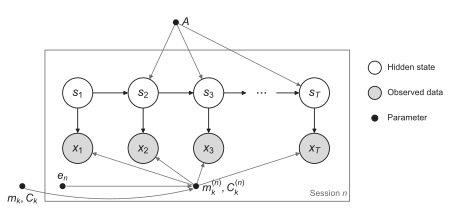
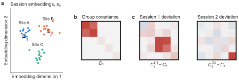

HMM with Integrated Variability Estimation (HIVE)
==================================================

HIVE [2] extends the :doc:`HMM <hmm>` to model **variability between sessions** while inferring dynamic networks across a group. The HMM gives every session the same state means and covariances, although sessions from different subjects, scanners or sites differ systematically. HIVE learns an **embedding vector** for each session, a "fingerprint", that adjusts the group-level state means and covariances to give session-specific ones. Sessions with similar networks have similar embeddings, so the embeddings capture sources of variation across the population (e.g. demographics, scanner or site) [2].

.. list-table::
   :widths: 25 75

   * - Time course
     - States: one state is active at each time point
   * - Observation model
     - Multivariate normal, with session-specific state means and covariances
   * - Temporal model
     - Markovian (transition probability matrix), shared by all sessions
   * - Training
     - As the HMM, no GPU needed
   * - API
     - :class:`~osl_dynamics.models.hive.Config`, :class:`~osl_dynamics.models.hive.Model`
   * - Examples
     - `Simulation <https://github.com/OHBA-analysis/osl-dynamics/blob/main/examples/simulation/hive_hmm-mvn.py>`_

Generative Model
----------------

The temporal model is the same as the :doc:`HMM <hmm>`'s. The observation model for session :math:`n` uses session-specific state means and covariances:

.. math::
    p(x_t | s_t = k, n) = \mathcal{N}(m^{(n)}_k, C^{(n)}_k).

The session-specific parameters are the **group-level** parameters, :math:`m_k` and :math:`C_k`, shared by all sessions, plus a **deviation** for each session:

- Each session has an **embedding vector**, :math:`e_n` (``embeddings_dim`` dimensions).
- Each state has a **spatial embedding** (``spatial_embeddings_dim`` dimensions), calculated from its group-level mean or covariance.
- A multi-layer perceptron (MLP) maps the session and spatial embeddings to the shape of the deviation, which is scaled by a magnitude for each session and state.
- The mean deviation is added to the group mean. The covariance deviation is added to the Cholesky factor of the group covariance, which keeps the session covariances positive definite.

    HIVE as a graphical model. Each session has an HMM with the shared transition probabilities, :math:`A`. The session's state means and covariances are calculated from the group-level parameters and the session embedding, :math:`e_n`.

    An illustration of what HIVE learns. **(a)** Session embeddings: sessions recorded at the same site have similar embeddings. **(b)** A group-level state covariance. **(c)** The deviations from the group covariance for two sessions from different sites (circled in **a**).

By default each session has its own embedding. Known information about the sessions can be passed with ``session_labels`` (a list of :class:`~osl_dynamics.data.SessionLabels`), e.g. a subject ID so that sessions from the same subject share an embedding, or a categorical (e.g. site) or continuous (e.g. age) variable. The embedding of a session is the sum of the embeddings for each of its labels.

Training
--------

HIVE in osl-dynamics [1] is trained as the :doc:`HMM <hmm>` is: the Baum-Welch algorithm calculates the posterior for the hidden states for each batch, the transition probability matrix is updated with a decaying exponential moving average, and the other parameters (group means and covariances, embeddings and the MLP) take gradient steps. The deviation magnitudes have a posterior distribution (a gamma distribution for each session and state) with a KL divergence term in the cost function, which regularizes the deviations. KL annealing (``do_kl_annealing=True``) can be used. The default initialization is :meth:`~osl_dynamics.models.initialization.InitializationMixin.random_state_time_course_initialization` (``init_method``), and :meth:`model.train <osl_dynamics.models.mod_base.ModelBase.train>` runs it before ``fit``.

The data need a session ID label, and :meth:`~osl_dynamics.models.hive.Model.set_regularizers` must be called before training. For example::

    import numpy as np
    from osl_dynamics.models.hive import Config, Model

    data.add_session_labels("session_id", np.arange(data.n_sessions), "categorical")

    config = Config(
        n_states=8,
        n_channels=data.n_channels,
        sequence_length=200,
        n_sessions=data.n_sessions,
        embeddings_dim=5,
        spatial_embeddings_dim=2,
        dev_n_layers=5,
        dev_n_units=32,
        dev_activation="tanh",
        dev_normalization="layer",
        dev_regularizer="l1",
        dev_regularizer_factor=0.01,
        learn_means=False,
        learn_covariances=True,
        do_kl_annealing=True,
        kl_annealing_curve="tanh",
        kl_annealing_sharpness=10,
        n_kl_annealing_epochs=20,
        batch_size=32,
        learning_rate=0.001,
        n_epochs=40,
    )
    model = Model(config)
    model.set_regularizers(data)
    model.set_dev_parameters_initializer(data)
    model.train(data)

where ``data`` is a :class:`~osl_dynamics.data.Data` object with one array per session.

Post-hoc Analysis
-----------------

The post-hoc analyses of the :doc:`HMM <hmm>` apply to HIVE's state time courses: summary statistics and multitaper spectra (see :doc:`Spectral Analysis </user_guide/spectra>`). In addition:

- :meth:`~osl_dynamics.models.hive.Model.get_summed_embeddings` returns the embedding of each session, and :meth:`~osl_dynamics.models.hive.Model.get_session_embeddings` the embeddings for each session label. The embeddings can be plotted (e.g. after PCA) to see how sessions cluster, or related to variables such as age, sex or scanner.
- :meth:`~osl_dynamics.models.hive.Model.get_group_means_covariances` returns the group-level state means and covariances, and :meth:`~osl_dynamics.models.hive.Model.get_session_means_covariances` the session-specific ones, which show how each session differs from the group.

Related Models
--------------

:mod:`DIVE <osl_dynamics.models.dive>` adds session embeddings to :doc:`DyNeMo <dynemo>` in the same way.

References
----------

1. C Gohil, et al., osl-dynamics, a toolbox for modeling fast dynamic brain activity. `eLife, 2024 <https://elifesciences.org/articles/91949>`_.
2. R Huang, C Gohil, M W Woolrich, Modelling variability in functional brain networks using embeddings. `Imaging Neuroscience, 2026 <https://doi.org/10.1162/IMAG.a.1188>`_.
