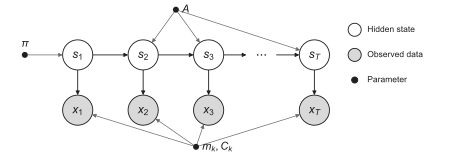
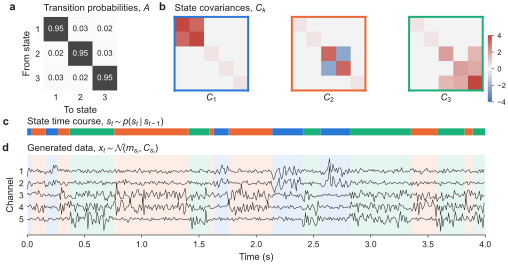
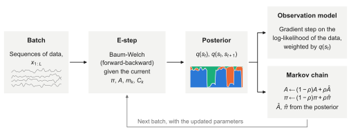
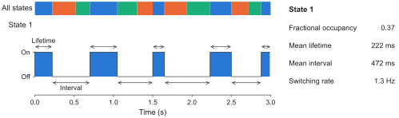

Hidden Markov Model (HMM)
=========================

The HMM describes a time series as a sequence of visits to a small number of **hidden states**. Each state has its own **observation model**, which describes the data while the state is active, and the order of the states is governed by a **transition probability matrix**. The HMM has been used to study fast transient networks in MEG [4, 9, 11], fMRI [10] and task data [12, 13, 16], and how they change with disease and age [14, 15, 17].

.. list-table::
   :widths: 25 75

   * - Time course
     - States: one state is active at each time point
   * - Observation model
     - Multivariate normal
   * - Temporal model
     - Markovian (transition probability matrix)
   * - Training
     - Baum-Welch algorithm with stochastic updates, no GPU needed
   * - API
     - :class:`~osl_dynamics.models.hmm.Config`, :class:`~osl_dynamics.models.hmm.Model`
   * - Tutorials
     - :doc:`HMM Training </tutorials_build/3-2_hmm_training>`, :doc:`Getting the Inferred Parameters </tutorials_build/3-5_hmm_dynemo_get_inf_params>`, :doc:`HMM post-hoc analysis </tutorial_sections/hmm_post_hoc>`
   * - Examples
     - `Simulation <https://github.com/OHBA-analysis/osl-dynamics/blob/main/examples/simulation/hmm_hmm-mvn.py>`_, `MEG (TDE-HMM, rest) <https://github.com/OHBA-analysis/osl-dynamics/tree/main/examples/meg_analysis/tde-hmm_rest>`_, `MEG (TDE-HMM, task) <https://github.com/OHBA-analysis/osl-dynamics/tree/main/examples/meg_analysis/tde-hmm_task>`_, `MEG (AE-HMM, rest) <https://github.com/OHBA-analysis/osl-dynamics/tree/main/examples/meg_analysis/ae-hmm_rest>`_, `fMRI <https://github.com/OHBA-analysis/osl-dynamics/tree/main/examples/fmri>`_

Generative Model
----------------

A generative model is the joint probability distribution of the observed data and the latent variables. For the HMM it is

.. math::
    p(x_{1:T}, s_{1:T}) = p(s_1) p(x_1 | s_1) \prod^T_{t=2} p(s_t | s_{t-1}) p(x_t | s_t),

where :math:`x_{1:T}` is the observed data (:math:`x_1, x_2, ..., x_T`) and :math:`s_{1:T}` is the sequence of hidden states (:math:`s_1, s_2, ..., s_T`), each of which takes one of :math:`K` values [2, 3].

The **observation model** is a multivariate normal distribution with a mean, :math:`m_k`, and covariance, :math:`C_k`, for each state:

.. math::
    p(x_t | s_t = k) = \mathcal{N}(m_k, C_k).

The **temporal model** depends only on the previous state (the **Markovian assumption**), so it is described by a :math:`K \times K` transition probability matrix, :math:`A`, and initial state probabilities, :math:`\pi`:

.. math::
    A_{ij} = p(s_t = j | s_{t-1} = i), \quad \pi_k = p(s_1 = k).

Each row of :math:`A` sums to one. The diagonal elements are the probabilities of staying in a state, so they control how long the states last.

    The HMM as a graphical model. Arrows show which variables each variable depends on. Each state depends only on the previous state.

To generate data from an HMM, we sample a state sequence using the transition probability matrix and then sample each data point from the observation model of the active state:

    Simulating data from an HMM with three states. **(a)** The transition probability matrix. **(b)** The state covariances (the means are zero). **(c)** A state sequence sampled using the transition probabilities. **(d)** Data sampled from the observation model of the active state at each time point: e.g. channels 1 and 2 have a high, correlated variance when state 1 is active.

What the states describe depends on how the data are prepared. With **amplitude envelope** (AE) data, the states differ in their means (``learn_means=True``). With **time-delay embedded** (TDE) data, the covariance of each state contains the power spectrum of each region and the coherence between regions, so the states are spectrally distinct networks and we only learn the covariances (``learn_means=False``). See the :doc:`time-delay embedding tutorial </tutorials_build/1-4_data_time_delay_embedding>` and the :doc:`FAQ </faq>` for more on AE vs TDE data.

Training
--------

Training (or fitting) the model means inferring the hidden states and the model parameters (:math:`\pi`, :math:`A`, :math:`m_k`, :math:`C_k`) from data. osl-dynamics [1] infers a posterior distribution for the hidden states, :math:`q(s_t)`, and learns point estimates for the parameters.

The data are split into sequences of ``sequence_length`` samples, which are grouped into batches of ``batch_size`` sequences. For each batch [5]:

#. **E-step**: the Baum-Welch (forward-backward) algorithm [2, 3] calculates the posterior for the hidden states, :math:`q(s_t)`, and for pairs of consecutive states, :math:`q(s_t, s_{t+1})`, given the current parameters.
#. **Observation model update**: the state means and covariances take a gradient step (with the Adam optimizer and ``learning_rate``) to minimize the negative log-likelihood of the data, weighted by the posterior,

   .. math::
       -\sum_t \sum_k q(s_t = k) \log \mathcal{N}(x_t | m_k, C_k).

#. **Markov chain update**: the transition probability matrix and initial state probabilities move towards the estimates from the posterior of this batch, :math:`\hat{A}` and :math:`\hat{\pi}`:

   .. math::
       A \leftarrow (1 - \rho) A + \rho \hat{A}, \quad \pi \leftarrow (1 - \rho) \pi + \rho \hat{\pi}.

   The step size decreases during training: after epoch :math:`e` (counting from zero), :math:`\rho = (1 + \delta + 100 e / E)^{-\kappa}`, where :math:`E` is ``n_epochs``, :math:`\delta` is ``trans_prob_update_delay`` and :math:`\kappa` is ``trans_prob_update_forget``.

    One training step. Each batch updates the parameters, which are then used for the E-step of the next batch.

The cost function is the **variational free energy**,

.. math::
    \mathcal{F} = \mathbb{E}_{q(s_{1:T})} \left[ \log q(s_{1:T}) - \log p(x_{1:T}, s_{1:T}) \right],

which :meth:`model.free_energy <osl_dynamics.models.inf_mod_base.MarkovStateInferenceModelBase.free_energy>` calculates. A lower free energy is a better fit, so it can be used to compare runs. A derivation of the cost function is :download:`here <images/hmm-cost-function.pdf>` (note, it uses different symbols to this page).

Initialization and Hyperparameters
^^^^^^^^^^^^^^^^^^^^^^^^^^^^^^^^^^

We recommend initializing the HMM with :meth:`~osl_dynamics.models.initialization.InitializationMixin.random_state_time_course_initialization`, which trains a few short runs from random state time courses and keeps the best. For example::

    from osl_dynamics.models.hmm import Config, Model

    config = Config(
        n_states=8,
        n_channels=data.n_channels,
        sequence_length=200,
        learn_means=False,
        learn_covariances=True,
        batch_size=256,
        learning_rate=0.01,
        n_epochs=20,
    )
    model = Model(config)
    model.random_state_time_course_initialization(data, n_init=3, n_epochs=1)
    model.fit(data)
    alpha = model.get_alpha(data)

where ``data`` is a :class:`~osl_dynamics.data.Data` object.

Alternatively, :meth:`model.train <osl_dynamics.models.mod_base.ModelBase.train>` runs the initialization set in the config (``init_method``, ``n_init``, ``n_init_epochs`` and ``init_take``) and then ``fit``.

We also recommend training several runs and keeping the one with the lowest free energy (``best_of`` in :meth:`model.train <osl_dynamics.models.mod_base.ModelBase.train>`), or the most typical run (:func:`~osl_dynamics.inference.modes.select_run`). The main hyperparameters are the number of states (``n_states``, 6-14 states is typical), ``sequence_length``, ``batch_size``, ``learning_rate`` and ``n_epochs``. The :doc:`FAQ </faq>` discusses how to choose them.

The State Time Course
^^^^^^^^^^^^^^^^^^^^^

After training, :meth:`model.get_alpha <osl_dynamics.models.inf_mod_base.MarkovStateInferenceModelBase.get_alpha>` returns the state probability time course, :math:`\alpha_{kt} = q(s_t = k)`, for each session. For a state time course with one state active at each time point, take the most probable state at each time point, the maximum a posteriori (MAP) estimate, with :func:`~osl_dynamics.inference.modes.argmax_time_courses`, or the most probable sequence of states with :meth:`model.get_viterbi_path <osl_dynamics.models.inf_mod_base.MarkovStateInferenceModelBase.get_viterbi_path>`. The learned parameters are returned by :meth:`~osl_dynamics.models.hmm.Model.get_means_covariances`, :meth:`~osl_dynamics.models.inf_mod_base.MarkovStateInferenceModelBase.get_trans_prob` and :meth:`~osl_dynamics.models.inf_mod_base.MarkovStateInferenceModelBase.get_initial_state_probs`. See the :doc:`Getting the Inferred Parameters tutorial </tutorials_build/3-5_hmm_dynemo_get_inf_params>`.

Canonical HMM Networks
^^^^^^^^^^^^^^^^^^^^^^

Instead of training a new HMM for each study, a pre-trained **canonical HMM** can be used to infer the state time courses for new data [6]. Canonical HMMs with 4-16 states, trained on a large MEG dataset in parcellated source space and in sensor space, are available in the `Canonical-HMM-Networks <https://github.com/OHBA-analysis/Canonical-HMM-Networks>`_ repository.

Post-hoc Analysis
-----------------

Post-hoc analysis interprets the inferred state time course: statistics that summarize the dynamics of each state, and the spectral properties (power and coherence) of each state. Further analyses (task data, the Fisher kernel and TINDA) are described :ref:`below <hmm-further-analyses>`.

Summary Statistics
^^^^^^^^^^^^^^^^^^

Four summary statistics describe the dynamics of each state:

- The **fractional occupancy** (:func:`~osl_dynamics.analysis.post_hoc.fractional_occupancies`) is the fraction of the total time spent in the state.
- The **mean lifetime** (:func:`~osl_dynamics.analysis.post_hoc.mean_lifetimes`), also known as the dwell time, is the average duration of a visit to the state.
- The **mean interval** (:func:`~osl_dynamics.analysis.post_hoc.mean_intervals`) is the average time between consecutive visits to the state.
- The **switching rate** (:func:`~osl_dynamics.analysis.post_hoc.switching_rates`) is the number of visits to the state per second.

    Summary statistics of state 1, calculated from the state time course. The values on the right are calculated by the osl-dynamics functions for the time course shown.

The summary statistics are calculated for each session (or subject) and can be compared between groups or conditions, or related to behavior, with the :doc:`statistical significance testing </user_guide/stats>` tools. See the :doc:`HMM Summary Statistics tutorial </tutorials_build/4-3_hmm_summary_stats>`.

Spectral Analysis
^^^^^^^^^^^^^^^^^

With TDE data the states are spectrally distinct, e.g. a state with high alpha (8-12 Hz) power in occipital regions. The power spectrum and coherence of each state are calculated from the data before time-delay embedding (and PCA) with :func:`~osl_dynamics.analysis.spectral.multitaper_spectra`, and power maps and coherence networks are calculated from the spectra. See :doc:`Spectral Analysis </user_guide/spectra>` for the method and how to plot the outputs, and the :doc:`HMM Multitaper Spectra </tutorials_build/4-1_hmm_multitaper_spectra>` and :doc:`HMM Plotting MEG Networks </tutorials_build/4-2_hmm_plotting_meg_networks>` tutorials.

For fMRI data, the state means and covariances of each subject are re-estimated with **dual estimation** (:meth:`~osl_dynamics.models.hmm.Model.dual_estimation`). See the :doc:`HMM fMRI Dual Estimation </tutorials_build/4-4_hmm_fmri_dual_estimation>` and :doc:`HMM Plotting fMRI Networks </tutorials_build/4-5_hmm_plotting_fmri_networks>` tutorials.

.. _hmm-further-analyses:

Further Analyses
----------------

Task Data
^^^^^^^^^

With task data, the state probability time course can be epoched around events to show how the network dynamics respond to a task [12, 16]. See the :doc:`Epoching Alphas tutorial </tutorials_build/6-1_epoching_alpha>` and the :doc:`Network Response tutorial </tutorials_build/7-3_network_response>` for statistical testing.

Fisher Kernel
^^^^^^^^^^^^^

The Fisher kernel (:class:`~osl_dynamics.analysis.fisher_kernel.FisherKernel`) measures the similarity between subjects from the gradients of the HMM's log-likelihood with respect to its parameters. It can be used to predict subject traits with kernel methods, such as kernel ridge regression or a support vector machine [7]. A derivation is :download:`here <images/hmm-fisher-kernel.pdf>`. See the `Fisher kernel example <https://github.com/OHBA-analysis/osl-dynamics/blob/main/examples/simulation/hmm_hmm-mvn_fisher-kernel.py>`_.

Temporal Interval Network Density Analysis (TINDA)
^^^^^^^^^^^^^^^^^^^^^^^^^^^^^^^^^^^^^^^^^^^^^^^^^^

TINDA (:func:`~osl_dynamics.analysis.tinda.tinda`) studies the order in which the states occur by asking which states are more likely in the first or second half of the interval between visits to each state. With the HMM, it has shown that large-scale networks activate in a structured cycle [8]. See the `TINDA example scripts <https://github.com/OHBA-analysis/osl-dynamics/tree/main/examples/tinda>`_.

References
----------

Methods
^^^^^^^

1. C Gohil, et al., osl-dynamics, a toolbox for modeling fast dynamic brain activity. `eLife, 2024 <https://elifesciences.org/articles/91949>`_.
2. L R Rabiner, A tutorial on hidden Markov models and selected applications in speech recognition. `Proceedings of the IEEE, 1989 <https://doi.org/10.1109/5.18626>`_.
3. C M Bishop, Pattern Recognition and Machine Learning, Chapter 13: Sequential Data. `Springer, 2006 <https://www.microsoft.com/en-us/research/publication/pattern-recognition-machine-learning/>`_.
4. D Vidaurre, et al., Spectrally resolved fast transient brain states in electrophysiological data. `NeuroImage, 2016 <https://www.sciencedirect.com/science/article/pii/S1053811915010691>`_.
5. D Vidaurre, et al., Discovering dynamic brain networks from big data in rest and task. `NeuroImage, 2018 <https://www.sciencedirect.com/science/article/pii/S1053811917305487>`_.
6. C Gohil, et al., Canonical hidden Markov model networks for studying M/EEG. `bioRxiv, 2025 <https://doi.org/10.1101/2025.10.21.683692>`_.
7. C Ahrends, M W Woolrich, D Vidaurre, Predicting individual traits from models of brain dynamics accurately and reliably using the Fisher kernel. `eLife, 2025 <https://elifesciences.org/articles/95125>`_.
8. M W J van Es, et al., Large-scale cortical functional networks are organized in structured cycles. `Nature Neuroscience, 2025 <https://doi.org/10.1038/s41593-025-02052-8>`_.

Applications
^^^^^^^^^^^^

9. A Baker, et al., Fast transient networks in spontaneous human brain activity. `eLife, 2014 <https://elifesciences.org/articles/01867>`_.
10. D Vidaurre, et al., Brain network dynamics are hierarchically organized in time. `PNAS, 2017 <https://doi.org/10.1073/pnas.1705120114>`_.
11. D Vidaurre, et al., Spontaneous cortical activity transiently organises into frequency specific phase-coupling networks. `Nature Communications, 2018 <https://doi.org/10.1038/s41467-018-05316-z>`_.
12. A Quinn, et al., Task-evoked dynamic network analysis through hidden Markov modeling. `Frontiers in Neuroscience, 2018 <https://doi.org/10.3389/fnins.2018.00603>`_.
13. C Higgins, et al., Replay bursts in humans coincide with activation of the default mode and parietal alpha networks. `Neuron, 2021 <https://www.sciencedirect.com/science/article/pii/S0896627320309661>`_.
14. T Sitnikova, et al., Short timescale abnormalities in the states of spontaneous synchrony in the functional neural networks in Alzheimer's disease. `NeuroImage: Clinical, 2018 <https://www.sciencedirect.com/science/article/pii/S2213158218301748>`_.
15. J Van Schependom, et al., Increased brain atrophy and lesion load is associated with stronger lower alpha MEG power in multiple sclerosis patients. `NeuroImage: Clinical, 2021 <https://doi.org/10.1016/j.nicl.2021.102632>`_.
16. C Gohil, et al., Dynamic network analysis of electrophysiological task data. `Imaging Neuroscience, 2024 <https://doi.org/10.1162/imag_a_00226>`_.
17. C Gohil, et al., Effects of age on resting-state cortical networks. `Human Brain Mapping, 2026 <https://doi.org/10.1002/hbm.70516>`_.
