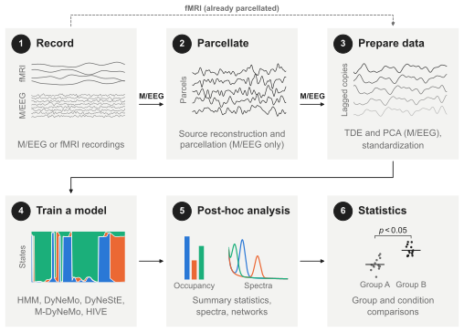
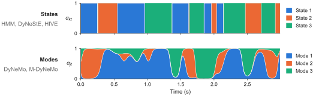

Models
======

osl-dynamics implements several generative models for inferring dynamic functional brain networks from time series data. All of the models share the same interface: a ``Config`` object sets the hyperparameters, a ``Model`` object is trained on a :class:`~osl_dynamics.data.Data` object, and the inferred state or mode time courses are passed to the post-hoc analysis tools in :mod:`osl_dynamics.analysis`. The :doc:`Getting Started </getting_started>` page has a short example.

The pages in this section describe each model: the generative model, how it is trained and the post-hoc analysis we recommend.

Where the Models Fit in an Analysis
-----------------------------------

    The steps of a typical analysis with osl-dynamics. fMRI data are usually already in parcels (or ICA components), so they skip step 2.

#. **Record** M/EEG or fMRI data.
#. **Parcellate** (M/EEG only): source reconstruct the sensor data to give a time course for each brain region (parcel). See :doc:`M/EEG Processing </user_guide/meeg>` and the :ref:`available parcellations <parcellations>`.
#. **Prepare the data** for the model: e.g. time-delay embedding, PCA and standardization for M/EEG, or standardization for fMRI. See the :doc:`MEG </tutorials_build/1-2_data_prepare_meg>`, :doc:`fMRI </tutorials_build/1-3_data_prepare_fmri>` and :doc:`time-delay embedding </tutorials_build/1-4_data_time_delay_embedding>` tutorials.
#. **Train a model**, described on the pages in this section. See the :doc:`Dynamic Modeling tutorials </tutorial_sections/dynamic_modelling>`.
#. **Post-hoc analysis** of the inferred state or mode time courses: summary statistics, spectra and power/coherence networks. See :doc:`Spectral Analysis </user_guide/spectra>` and the :doc:`HMM </tutorial_sections/hmm_post_hoc>` and :doc:`DyNeMo </tutorial_sections/dynemo_post_hoc>` post-hoc tutorials.
#. **Statistics**: compare groups or conditions, or relate the dynamics to behavior. See :doc:`Statistical Significance Testing </user_guide/stats>`.

States and Modes
----------------

The models describe the data with a small number of networks, each with its own mean and covariance (the observation model), and a time course that says when each network is active. There are two kinds of time course:

- **States** (HMM, DyNeStE, HIVE) are mutually exclusive: one state is active at each time point. The state probability time course, :math:`\alpha_{kt}`, is the probability that state :math:`k` is active at time :math:`t`. States give summary statistics directly, such as how long each state lasts.
- **Modes** (DyNeMo, M-DyNeMo) mix: the covariance at each time point is a weighted sum of the mode covariances, with the mixing coefficients, :math:`\alpha_{jt}`, as weights. Modes can describe networks that overlap in time. M-DyNeMo has one set of mixing coefficients for power (:math:`\alpha_{jt}`) and another for functional connectivity (:math:`\beta_{jt}`).

    Simulated time courses for three states (top) and three modes (bottom). One state is active at each time point, whereas the mixing coefficients of the modes are positive and sum to one at each time point.

.. _choosing-a-model:

Choosing a Model
----------------

.. list-table::
   :header-rows: 1
   :widths: 14 20 22 18 26

   * - Model
     - Time course
     - Temporal model
     - Training
     - Use when
   * - :doc:`HMM <hmm>`
     - States
     - Markovian (transition probability matrix)
     - Fast, no GPU needed
     - A good default: interpretable summary statistics, e.g. for resting-state data
   * - :doc:`DyNeMo <dynemo>`
     - Modes (linear mixture)
     - Recurrent neural network
     - Slower, a GPU helps
     - Networks overlap in time, e.g. task responses
   * - :doc:`DyNeStE <dyneste>`
     - States
     - Recurrent neural network
     - Slower, a GPU helps
     - You want states and long-range temporal dependencies
   * - :doc:`M-DyNeMo <mdynemo>`
     - Modes, separate for power and FC
     - Recurrent neural networks
     - Slower, a GPU helps
     - Power and functional connectivity may change independently
   * - :doc:`HIVE <hive>`
     - States, with session-specific networks
     - Markovian (transition probability matrix)
     - Fast, no GPU needed
     - Sessions differ systematically, e.g. subjects, scanners or sites

The :doc:`FAQ </faq>` has more guidance on choosing a model, the number of states/modes and the other hyperparameters.

Further models are documented in the API reference only: :mod:`DIVE <osl_dynamics.models.dive>` (DyNeMo with embeddings for inter-session variability), :mod:`SC-DyNeMo <osl_dynamics.models.sc_dynemo>` (single-channel DyNeMo), :mod:`HMM-Poisson <osl_dynamics.models.hmm_poi>` (an HMM for spike count data) and :mod:`HMM-Dirichlet <osl_dynamics.models.hmm_dirichlet>`. There are example scripts for training each model on simulated data in `examples/simulation <https://github.com/OHBA-analysis/osl-dynamics/tree/main/examples/simulation>`_.

.. toctree::
   :maxdepth: 1

   hmm
   dynemo
   dyneste
   mdynemo
   hive
