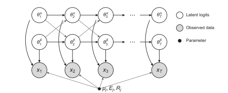
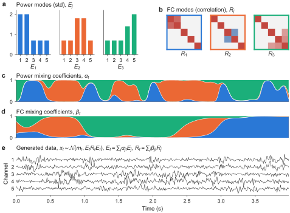

Multi-Dynamic Network Modes (M-DyNeMo)
======================================

M-DyNeMo [2] extends :doc:`DyNeMo <dynemo>` [3] with **separate dynamics for power and functional connectivity (FC)**. DyNeMo describes both with the same mixing coefficients, so a change in a region's power always comes with a change in its connectivity. M-DyNeMo relaxes this: power and FC have their own modes and mixing coefficients, so one can change without the other. On MEG data, M-DyNeMo found transient power and FC dynamics that are largely uncoupled [2].

.. list-table::
   :widths: 25 75

   * - Time course
     - Two sets of modes: mixing coefficients for power, :math:`\alpha_{jt}`, and for FC, :math:`\beta_{jt}`
   * - Observation model
     - Multivariate normal, with a covariance built from a mixture of standard deviations and a mixture of correlations
   * - Temporal model
     - Recurrent neural network (LSTM by default)
   * - Training
     - Amortized variational inference, a GPU helps
   * - API
     - :class:`~osl_dynamics.models.mdynemo.Config`, :class:`~osl_dynamics.models.mdynemo.Model`
   * - Examples
     - `Simulation <https://github.com/OHBA-analysis/osl-dynamics/blob/main/examples/simulation/mdynemo_hmm-mvn.py>`_

Generative Model
----------------

M-DyNeMo separates the covariance at each time point into **standard deviations** (power) and **correlations** (FC), each with its own set of modes and mixing coefficients:

.. math::
    p(x_t | \theta^{\alpha}_t, \theta^{\beta}_t) = \mathcal{N}(m_t, C_t), \quad C_t = E_t R_t E_t,

where

- :math:`E_t = \sum_j \alpha_{jt} E_j` is a diagonal matrix of standard deviations, a mixture of the **power modes**, :math:`E_j`;
- :math:`R_t = \sum_j \beta_{jt} R_j` is a correlation matrix, a mixture of the **FC modes**, :math:`R_j`;
- :math:`m_t = \sum_j \alpha_{jt} \mu_j` is the mean.

The power mixing coefficients, :math:`\alpha_{jt}`, and FC mixing coefficients, :math:`\beta_{jt}`, are softmax transforms of two sets of logits, :math:`\theta^{\alpha}_t` and :math:`\theta^{\beta}_t`. As in DyNeMo, a recurrent neural network (the **model RNN**) predicts the distribution of the logits at each time point from all of the previous logits of both sets.

    M-DyNeMo as a graphical model. Separate logits for power (:math:`\theta^{\alpha}`) and FC (:math:`\theta^{\beta}`) both generate the data. The model RNN predicts each logit from the history of both sets (gray arrows; the long-range arcs of :doc:`DyNeMo <dynemo>` are left out for clarity).

    Simulating data from M-DyNeMo with three power modes and three FC modes. **(a)** The standard deviations of the power modes. **(b)** The correlations of the FC modes. **(c)** The power mixing coefficients. **(d)** The FC mixing coefficients, which change more slowly here. **(e)** Data sampled with the covariance at each time point.

The number of power modes (``n_modes``) and FC modes (``n_corr_modes``) can be different.

Training
--------

M-DyNeMo in osl-dynamics [1] is trained in the same way as :doc:`DyNeMo <dynemo>`, with **amortized variational inference**: a bidirectional inference RNN predicts the posterior for both sets of logits from the data, and the cost function is the variational free energy, with a KL divergence term for each set of logits. KL annealing (``do_kl_annealing=True``) helps training. The recommended initialization is :meth:`~osl_dynamics.models.initialization.InitializationMixin.random_subset_initialization` (the default ``init_method``), and :meth:`model.train <osl_dynamics.models.mod_base.ModelBase.train>` runs it before ``fit``.

The standard deviations, correlations and means are learned if ``learn_stds``, ``learn_corrs`` and ``learn_means`` are ``True``. They are returned by :meth:`~osl_dynamics.models.mdynemo.Model.get_means_stds_corrs`. For example::

    from osl_dynamics.models.mdynemo import Config, Model

    config = Config(
        n_modes=6,
        n_corr_modes=6,
        n_channels=data.n_channels,
        sequence_length=200,
        inference_n_units=64,
        inference_normalization="layer",
        model_n_units=64,
        model_normalization="layer",
        learn_means=False,
        learn_stds=True,
        learn_corrs=True,
        do_kl_annealing=True,
        kl_annealing_curve="tanh",
        kl_annealing_sharpness=10,
        n_kl_annealing_epochs=20,
        batch_size=32,
        learning_rate=0.01,
        n_epochs=40,
    )
    model = Model(config)
    model.train(data)
    alpha, beta = model.get_alpha(data)

where ``data`` is a :class:`~osl_dynamics.data.Data` object.

Post-hoc Analysis
-----------------

:meth:`model.get_alpha <osl_dynamics.models.inf_mod_base.VariationalInferenceModelBase.get_alpha>` returns both sets of mixing coefficients: the power mixing coefficients, :math:`\alpha_{jt}`, and the FC mixing coefficients, :math:`\beta_{jt}`. Each set can be analyzed in the same way as the :doc:`DyNeMo <dynemo>` mixing coefficients:

- **Re-weighting** with :func:`~osl_dynamics.inference.modes.reweight_mtc`, which accounts for the size of each mode's covariance or correlations.
- **Summary statistics**, e.g. the mean, standard deviation or kurtosis of the mixing coefficients, or the HMM summary statistics after binarizing them with :func:`~osl_dynamics.inference.modes.gmm_time_courses`.
- **Spectral analysis** with the regression spectra (:func:`~osl_dynamics.analysis.spectral.regression_spectra`). See :doc:`Spectral Analysis </user_guide/spectra>`.

Comparing the power and FC time courses shows how closely power and FC dynamics are related, e.g. with the correlation between :math:`\alpha_{jt}` and :math:`\beta_{jt}`.

References
----------

1. C Gohil, et al., osl-dynamics, a toolbox for modeling fast dynamic brain activity. `eLife, 2024 <https://elifesciences.org/articles/91949>`_.
2. R Huang, C Gohil, M W Woolrich, Evidence for transient, uncoupled power and functional connectivity dynamics. `Human Brain Mapping, 2025 <https://doi.org/10.1002/hbm.70179>`_.
3. C Gohil, et al., Mixtures of large-scale dynamic functional brain network modes. `NeuroImage, 2022 <https://doi.org/10.1016/j.neuroimage.2022.119595>`_.
