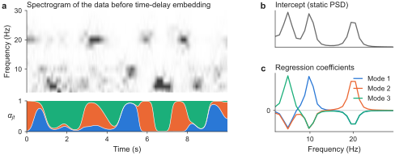
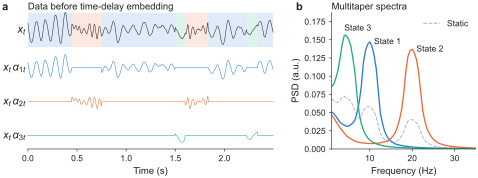

Spectral Analysis
=================

After training a model on time-delay embedded (TDE) data, we describe each state or mode by its power spectral density (PSD) and coherence. These are calculated from the parcel time courses before time-delay embedding (and PCA), using the inferred state probabilities or mixing coefficients (:code:`alpha`).

.. list-table::
   :header-rows: 1
   :widths: 35 20 45

   * - Function
     - Models
     - Returns
   * - :func:`~osl_dynamics.analysis.spectral.regression_spectra`
     - All models (states and modes)
     - :class:`~osl_dynamics.analysis.spectral.RegressionSpectra`: the static spectrum and the change from the static spectrum for each state/mode
   * - :func:`~osl_dynamics.analysis.spectral.multitaper_spectra`
     - Models with states (HMM, DyNeStE, HIVE)
     - :class:`~osl_dynamics.analysis.spectral.StateSpectra`: the spectrum of each state
   * - :func:`~osl_dynamics.analysis.static.welch_spectra`, :func:`~osl_dynamics.analysis.static.multitaper_spectra`
     - No model (static analysis)
     - :class:`~osl_dynamics.analysis.spectral.Spectra`: the spectrum of each session

For examples with real data, see the :doc:`HMM Multitaper Spectra </tutorials_build/4-1_hmm_multitaper_spectra>` and :doc:`HMM Plotting MEG Networks </tutorials_build/4-2_hmm_plotting_meg_networks>` tutorials (multitaper), and the :doc:`DyNeMo Regression Spectra </tutorials_build/5-1_dynemo_regression_spectra>` and :doc:`DyNeMo Plotting Networks </tutorials_build/5-2_dynemo_plotting_networks>` tutorials (regression).

Calculating spectra
-------------------

Pass the :class:`~osl_dynamics.data.Data` object used for training and :code:`alpha` for each session (:code:`model.get_alpha(data)`):

.. code-block:: python

    from osl_dynamics.analysis import spectral

    spectra = spectral.multitaper_spectra(data, alpha=alpha, frequency_range=[1, 45])
    spectra = spectral.regression_spectra(data, alpha=alpha, frequency_range=[1, 45])

The data before preparation (time-delay embedding, PCA, etc.) is used, aligned to :code:`alpha`. Arrays of parcel time courses can also be passed, with the same number of samples as :code:`alpha` (see :meth:`Data.trim_time_series <osl_dynamics.data.Data.trim_time_series>`) and the :code:`sampling_frequency`.

The result stores the cross spectra of each session, which can be saved and loaded:

.. code-block:: python

    spectra.save("spectra.npz")
    spectra = spectral.Spectra.load("spectra.npz")

Pass :code:`cross_spectra=False` to only calculate the PSDs (no coherence), e.g. for a large number of channels.

Quantities
**********

Each quantity is an attribute of the result. The first axis is the session.

.. list-table::
   :header-rows: 1
   :widths: 30 30 40

   * - Quantity
     - PSD, coherence
     - Shape
   * - State/mode spectrum, :math:`P_j`
     - :code:`psd`, :code:`coherence`
     - (sessions, states, channels, [channels,] frequencies)
   * - Static spectrum, :math:`S`
     - :code:`static_psd`, :code:`static_coherence`
     - (sessions, channels, [channels,] frequencies)
   * - Change from the static spectrum, :math:`P_j - S`
     - :code:`psd_change`, :code:`coherence_change`
     - (sessions, states, channels, [channels,] frequencies)
   * - Regression coefficients, :math:`\beta_j` (regression only)
     - :code:`psd_coefs`, :code:`coherence_coefs`
     - (sessions, modes, channels, [channels,] frequencies)
   * - Standard deviation, :math:`\sigma_j` (regression only)
     - :code:`sigma`
     - (modes,)

The frequency axis is :code:`frequencies` and the weight of each session in a group average is :code:`weights`. :code:`cross_spectra` gives the complex cross spectra, :math:`\langle \bar{X}_x X_y \rangle`.

Regression spectra
------------------

The spectrum at time :math:`t` is modeled as a mixture of the spectra of each state/mode:

.. math::
    P_t(f) = \sum_j \alpha_{jt} P_j(f).

:func:`~osl_dynamics.analysis.spectral.regression_spectra` calculates a spectrogram :math:`P_t` (cross spectra in a sliding window of :code:`window_length` samples, each split into :code:`n_sub_windows` Hann-tapered sub-windows), averages :code:`alpha` over the same windows and fits the mixture with least squares, i.e. a `GLM-spectrum <https://doi.org/10.1162/imag_a_00082>`_. The frequency resolution is set by the sub-window length, :code:`window_length / n_sub_windows` samples. The default is a 4 second window with 8 sub-windows (2 Hz resolution) and an 80 ms step.

    Regression spectra for simulated data where the power of a different oscillation is proportional to each mode's mixing coefficient. **(a)** The spectrogram of the data and the mixing coefficients. **(b)** The intercept of the regression, the static PSD. **(c)** The regression coefficients for each mode.

Definitions
***********

**Static spectrum** :math:`S`. The time-averaged spectrum of the data, :math:`S = \sum_j \bar{\alpha}_j P_j`, where :math:`\bar{\alpha}_j` is the mean of :code:`alpha` for mode :math:`j`. This is the intercept of the regression.

**Mode spectrum** :math:`P_j`. The spectrum when only state/mode :math:`j` is active. For the HMM, this is the spectrum of the state. For DyNeMo, the mixing coefficients of a mode rarely approach one, so :math:`P_j` is an extrapolation that doesn't typically arise.

**Standard deviation** :math:`\sigma_j`. The standard deviation of the windowed :code:`alpha` for mode :math:`j`, averaged over sessions. It is the typical size of the fluctuations in a mode's :code:`alpha` over the window length.

**Coefficients** :math:`\beta_j = \sigma_j (P_j - S)`. The change in the spectrum from the static spectrum for a one standard deviation increase in mode :math:`j`'s :code:`alpha`. :math:`P_j = S + \beta_j / \sigma_j`.

**Change in coherence** :math:`C_j` (:code:`coherence_coefs`). The change in the cross spectrum in the direction of the static cross spectrum, normalized by the static power, for a one standard deviation increase in mode :math:`j`'s :code:`alpha`:

.. math::
    C_{jxy} = \frac{\text{Re}(\beta_{jxy} e^{-i\phi_{xy}})}{\sqrt{S_{xx} S_{yy}}},

where :math:`\phi_{xy}` is the phase of :math:`S_{xy}`. It includes changes in both coherence and power: it increases when the coherence between :math:`x` and :math:`y` increases or when the power at :math:`x` or :math:`y` increases. The diagonal is the relative change in power, :math:`\beta_{jxx} / S_{xx}`.

Positive coefficients mean a mode has more power than the static spectrum and negative coefficients mean less. The changes of all modes balance around the static spectrum, so some modes can be negative everywhere: e.g. a DyNeMo mode with a small covariance that takes most of the mixing coefficients.

Sessions
********

The coefficients of every session are scaled by the same :math:`\sigma_j`, so session-specific spectra have the same units and can be averaged or compared with :doc:`statistical tests </user_guide/stats>`.

- Calculate the spectra for all the sessions you want to compare in one call. To compare spectra from separate calls or different window settings, use :code:`psd_change` (:math:`\beta_j / \sigma_j`).
- Session-specific estimates are noisier for sessions where a mode's :code:`alpha` varies less than :math:`\sigma_j`.
- A mode whose :code:`alpha` is (nearly) constant in a session (e.g. an HMM state that is never visited) has NaN coefficients. :meth:`~osl_dynamics.analysis.spectral.Spectra.group_average` ignores them.

Multitaper spectra
------------------

:func:`~osl_dynamics.analysis.spectral.multitaper_spectra` estimates the spectrum of each state, :math:`P_j`, directly:

#. Multiply the data by the state probability time course, :math:`\alpha_{jt}`, to keep the time points when state :math:`j` is active.
#. Split the result into non-overlapping windows. A window twice the sampling frequency gives a frequency resolution of 0.5 Hz.
#. Multiply each window by several tapers (hence the name 'multitaper'), Fourier transform each tapered window and average the squared magnitudes over the tapers to estimate the PSD of the window.
#. Average the PSDs of the windows.

    Multitaper spectra for simulated data with a different oscillation in each state. **(a)** The data before time-delay embedding, and the data multiplied by each state's probability time course. **(b)** The PSD of each state and the static PSD of all the data.

The static spectrum, :math:`S`, is the average of the state spectra weighted by the fractional occupancies (:code:`fractional_occupancies`). A state that is never active in a session has NaN spectra for that session.

The multitaper is the recommended method for HMM states. The multitaper spectra have broader peaks and smaller differences between states than the regression spectra. To compare the two methods, use :code:`psd_change` (:math:`P_j - S`) from both.

What to plot
------------

Plot the change from the static spectrum: the coefficients for regression spectra and :math:`P_j - S` for multitaper spectra. These are the defaults of the methods below. Calculate the group average first:

.. code-block:: python

    group = spectra.group_average()

:meth:`~osl_dynamics.analysis.spectral.Spectra.group_average` averages the cross spectra over sessions with :code:`weights` (the number of samples in each session), ignoring NaN values. The coherences are calculated from the group-averaged cross spectra.

PSDs
****

:meth:`~osl_dynamics.analysis.spectral.Spectra.plot_psd` plots the PSD of each state/mode averaged over parcels, with the standard error over parcels:

.. code-block:: python

    # Change from the static PSD
    group.plot_psd(filename="psd_change.png")

    # PSD of each state with the static PSD
    group.plot_psd(values="psd", static=True, filename="psd.png")

For DyNeMo, :math:`P_j` is an extrapolation: plot the coefficients. Pass :code:`channels` to plot a subset of parcels.

Power maps and coherence networks
*********************************

.. code-block:: python

    from osl_dynamics.analysis import power, connectivity

    # Power maps
    p = group.power_maps()  # (states, parcels)
    power.save(p, parcellation_file=parcellation_file, filename="pow_.png", plot_kwargs={"symmetric_cbar": True})

    # Coherence networks: the 3% of edges with the largest changes
    c = group.coherence_networks(percentile=97)  # (states, parcels, parcels)
    connectivity.save(c, parcellation_file=parcellation_file, filename="coh_.png")

- **Power maps.** The change in power from the static power averaged over frequency, as a fraction of each parcel's variance (with the default :code:`standardize=True`). Red is an increase and blue a decrease. Use the change from the static power, not :math:`P_j`, to compare states/modes.
- **Coherence networks.** The edges with the largest changes in coherence, increases (red) and decreases (blue).

Pass :code:`values` to use another quantity, e.g. :code:`values="psd"` or :code:`values="coherence"`.

Frequency bands
***************

Pass :code:`frequency_range` for one band, or :code:`bands` for several:

.. code-block:: python

    p = group.power_maps(frequency_range=[8, 13])  # (states, parcels)
    p = group.power_maps(bands=[[1, 4], [4, 8], [8, 13], [13, 30]])  # (bands, states, parcels)

High-frequency activity can make the coherence networks noisy, so the spectra are often separated into frequency bands ('spectral components') with non-negative matrix factorization:

.. code-block:: python

    components = spectra.decompose(n_components=2)  # (components, frequencies)
    p = group.power_maps(bands=components)  # (components, states, parcels)
    c = group.coherence_networks(bands=components, percentile=97)

Pass :code:`component=i` to :func:`~osl_dynamics.analysis.power.save` and :func:`~osl_dynamics.analysis.connectivity.save` to plot component :code:`i`.

Statistics
**********

Use the session-specific spectra (without :code:`group_average`) for :doc:`statistical tests </user_guide/stats>`. The first axis is the session:

.. code-block:: python

    from osl_dynamics import stats

    p = spectra.power_maps(frequency_range=[8, 13])  # (sessions, states, parcels)
    c = spectra.coherence_networks(frequency_range=[8, 13], vectorize=True)  # (sessions, states, edges)
    result = stats.group_diff(p, assignments)

:code:`vectorize=True` returns the upper triangle of each network; :func:`~osl_dynamics.utils.array_ops.vec2mat` converts it back to a matrix.
